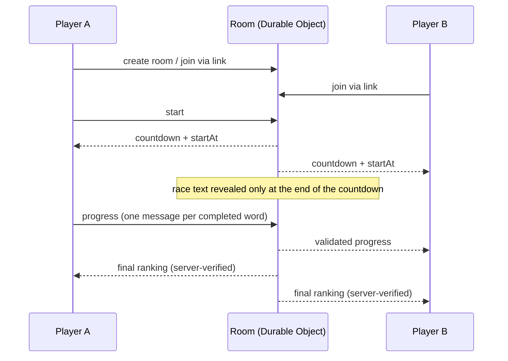

<div align="center">

<a href="https://erotype.erotype.workers.dev">
  
</a>

# EroType

**A minimalist typing speed test with real-time multiplayer races.**

Share a link, race your friends, track your personal bests. Turkish and English, out of the box.

<p>
  <a href="https://erotype.erotype.workers.dev"></a>
  <a href="LICENSE"></a>
  
  
  
  
  
</p>

<p>
  <a href="#features">Features</a> ·
  <a href="#tech-stack">Tech stack</a> ·
  <a href="#getting-started">Getting started</a> ·
  <a href="#contributing">Contributing</a> ·
  <a href="#license">License</a>
</p>

<!-- Screenshot: add an image at .github/assets/screenshot.png and uncomment the line below -->
<!--  -->

</div>

---

## Features

**Solo practice**
- Time, word-count and quote modes, with optional punctuation and numbers
- Live WPM / accuracy, a detailed result chart and personal bests
- Server-verified scores — results are recomputed on the server, not trusted from the client
- 18 colour themes, multiple caret styles and keyboard sound profiles
- Focus mode that hides the UI while you type

**Multiplayer races**
- Create a room and share a short link (`/r/AB12CD`) — no sign-up needed to join
- 2–8 racers plus up to 8 spectators per room
- Server-authoritative countdown, text and finishing order
- Smoothly interpolated opponent progress, bots for testing, instant rematch

**Accounts & leaderboards**
- Sign in with Google or GitHub
- Profiles, personal bests per mode, global leaderboards
- One-click account deletion

**Languages**
- Turkish and English UI and word lists
- Data-driven language packs — adding a language means adding a folder under `data/languages/<code>/`

## Tech stack

| Layer | Technology |
| --- | --- |
| Language | TypeScript everywhere (client, server, shared game logic) |
| Frontend | React 19 + Vite; the typing engine and race animation are framework-free TypeScript |
| API | [Hono](https://hono.dev) on a single Cloudflare Worker that also serves the static assets |
| Real-time | Cloudflare **Durable Objects** — one object per room, WebSocket Hibernation API, DO alarms |
| Database | Cloudflare **D1** (SQLite) with [Drizzle ORM](https://orm.drizzle.team) |
| Auth | [Better Auth](https://www.better-auth.com) (Google & GitHub OAuth) |
| Tests | [Vitest](https://vitest.dev) |

### How a race works



The server is the single source of truth: it picks the text, schedules the start, validates every progress update
(speed limits, timing, ordering) and decides the final ranking. Clients only render the local typing experience.

### Project structure

```
src/
├── client/          # React app
│   ├── components/  # UI components
│   ├── race/        # opponent interpolation, bots
│   ├── typing/      # framework-free typing engine, sounds, personal bests
│   └── styles/      # themes (CSS variables)
├── server/          # Cloudflare Worker
│   ├── game/        # pure room/race logic (no Cloudflare APIs, unit-tested)
│   ├── db/          # Drizzle schema
│   ├── index.ts     # Hono API + routing
│   └── room-do.ts   # Durable Object for a race room
└── shared/          # protocol, stats, text generation, verification
data/languages/      # word lists and quotes per language
migrations/          # D1 SQL migrations
```

## Getting started

### Prerequisites

- [Node.js](https://nodejs.org) 20 or newer
- A free [Cloudflare](https://dash.cloudflare.com/sign-up) account (only needed for deploying)

### Local development

```bash
git clone https://github.com/yagizerhan/erotype.git
cd erotype
npm install

# Local secrets (optional for localhost — dev defaults are used if left empty)
cp .dev.vars.example .dev.vars

npm run dev        # applies local D1 migrations, then starts Vite at http://localhost:5173
```

OAuth sign-in only works after you fill in the Google / GitHub client IDs and secrets in `.dev.vars`
(see the comments in [`.dev.vars.example`](.dev.vars.example)). Everything else — solo tests, multiplayer rooms,
bots — works without any configuration.

### Scripts

| Command | Description |
| --- | --- |
| `npm run dev` | Start the dev server (Vite + local Worker, D1 and Durable Objects) |
| `npm test` | Run the unit tests once |
| `npm run test:watch` | Run tests in watch mode |
| `npm run build` | Type-check and build for production |
| `npm run db:migrate:local` | Apply D1 migrations to the local database |
| `npm run db:migrate:remote` | Apply D1 migrations to the production database |
| `npm run deploy` | Test, build and deploy to Cloudflare |

### Deploying your own instance

1. `npx wrangler d1 create <your-db-name>` and put the returned `database_id` / name into `wrangler.jsonc`
   (and the `db:migrate:*` scripts).
2. `npm run db:migrate:remote`
3. Set the production secrets: `node scripts/set-secrets.mjs` (or `npx wrangler secret put <NAME>` for each value
   listed in `.dev.vars.example`).
4. `npm run deploy`

> [!IMPORTANT]
> If you run a modified version publicly, the AGPL-3.0 requires you to offer its source code to your users, and
> you must use your own name and logo — see [TRADEMARKS.md](TRADEMARKS.md).

## Contributing

Contributions are welcome! Please read [CONTRIBUTING.md](CONTRIBUTING.md) first. In short:

1. Open an issue to discuss larger changes.
2. Fork, create a branch, make your change and add tests where it makes sense.
3. Make sure `npm test` and `npm run build` pass.
4. Sign off your commits (`git commit -s`) and open a pull request.

## Acknowledgements

EroType is inspired by [Monkeytype](https://github.com/monkeytypegame/monkeytype) — think of it as a take on that
experience with real-time online races and a few extras. No Monkeytype source code is used; some keyboard sound
samples are used under GPL-3.0 with attribution. Word lists, quotes and other third-party material are credited in
[THIRD_PARTY_NOTICES.md](THIRD_PARTY_NOTICES.md).

## License

EroType is free software licensed under the [GNU Affero General Public License v3.0](LICENSE) or later.
Copyright © 2026 yagizerhan.

The **EroType** name and logo are not covered by the license — see [TRADEMARKS.md](TRADEMARKS.md).
